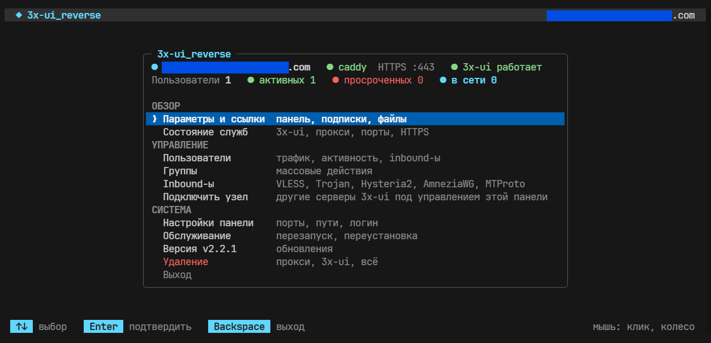
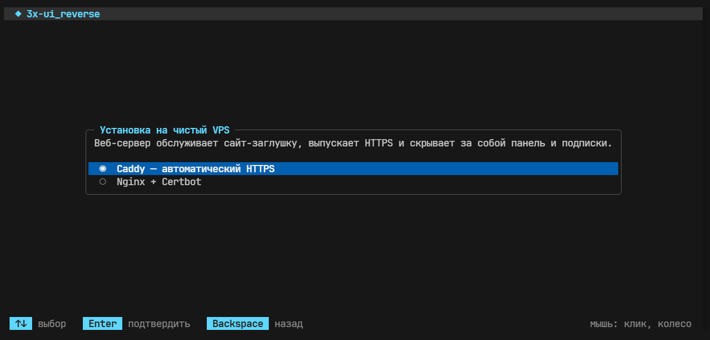
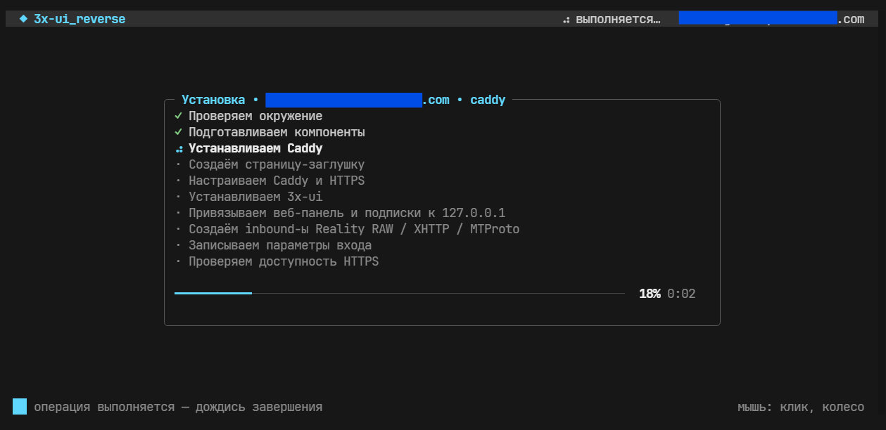
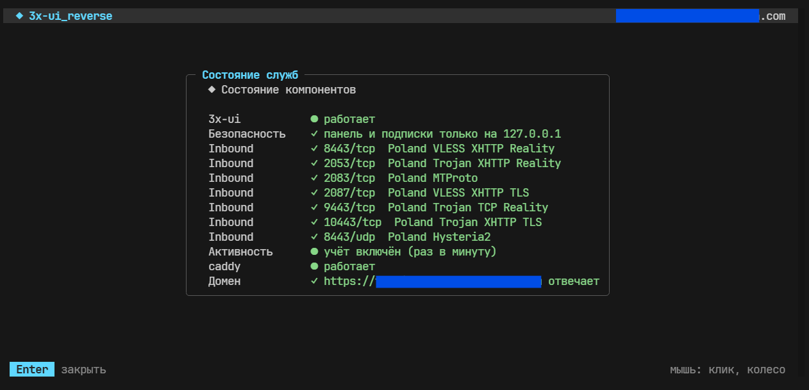
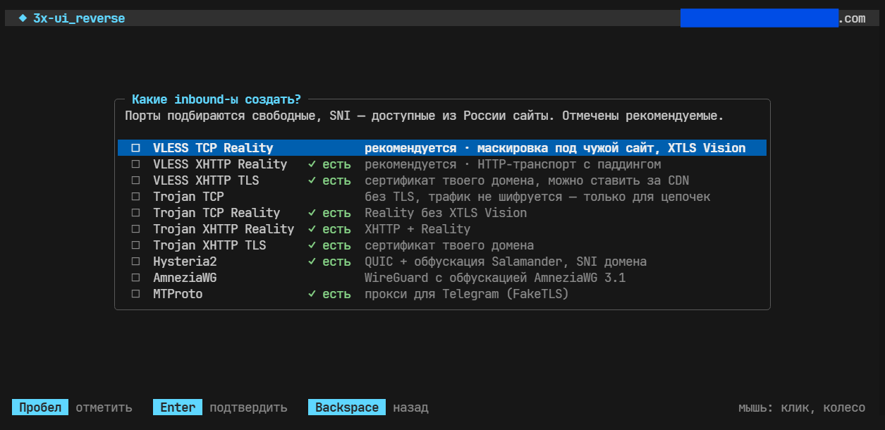
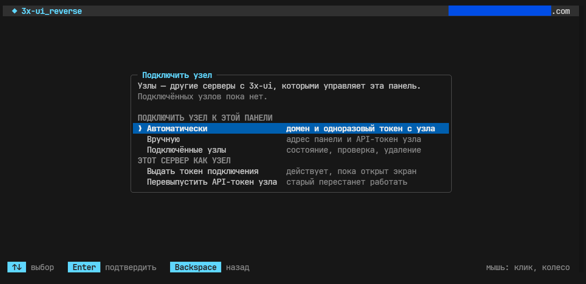

# 3x-ui_reverse

**Русский** | [English](#english)




<details>
  <summary>Больше снимков экрана / more screenshots</summary>

 
 
 
 
 


</details>


## Русский

**3x-ui_reverse** — скрипт для установки и управления панелью **3x-ui** за обратным прокси **Caddy** или **Nginx** на VPS с Debian/Ubuntu. Снаружи сервер выглядит как обычный сайт с HTTPS. Панель и подписки спрятаны за случайными путями. Скрипт создаёт inbound-ы с учётом блокировок в России: VLESS и Trojan (Reality, XHTTP, TLS), Hysteria2, AmneziaWG и MTProto для Telegram. Несколько серверов можно объединить: один управляет остальными как узлами.

### Возможности

**Установка**
- Проверка DNS до начала установки — как на dnschecker: A-запись домена опрашивается через 16 публичных DNS-серверов разных стран и у авторитетного сервера домена и сравнивается с IP VPS.
- Caddy или Nginx + Certbot с автоматическим выпуском и продлением сертификатов HTTPS.
- Страница-заглушка «Скоро открытие» на главной странице домена.
- 3x-ui ставится официальным установщиком. Панель и подписки слушают только `127.0.0.1` — даже при самом первом запуске.
- Случайные логин, пароль, пути и внутренние порты панели и подписок.
- По желанию — inbound-ы и пользователь `user1`, сразу после установки (список выбирается галочками, см. ниже).

**Inbound-ы**

| Тип | Транспорт | Особенности |
|---|---|---|
| VLESS TCP Reality ★ | TCP | маскировка под чужой сайт, XTLS Vision |
| VLESS XHTTP Reality ★ | TCP | HTTP-транспорт с паддингом |
| VLESS XHTTP TLS | TCP | сертификат домена или свой; можно ставить за CDN |
| Trojan TCP | TCP | без TLS, трафик не шифруется — только для цепочек серверов |
| Trojan TCP Reality | TCP | Reality без XTLS Vision |
| Trojan XHTTP Reality | TCP | XHTTP + Reality |
| Trojan XHTTP TLS | TCP | сертификат домена или свой |
| Hysteria2 | UDP | QUIC + обфускация Salamander, сертификат и SNI домена |
| AmneziaWG | UDP | WireGuard с обфускацией AmneziaWG 3.1 (ключи и параметры генерирует панель) |
| MTProto ★ | TCP | прокси для Telegram (FakeTLS) |

★ — отмечены по умолчанию.

- Названия — `{Страна по-английски} {inbound}`, например `Netherlands VLESS TCP Reality`. Страна определяется по IP VPS; совпадающие названия получают номер.
- Порты подбираются свободные и привычные для HTTPS-трафика (8443, 2053, 2083, 2087, 9443…); для UDP — сначала 443/udp, он не мешает прокси на 443/tcp.
- SNI для Reality и MTProto — сайты, доступные из России и не на Cloudflare; каждый проверяется сканером панели (TLS 1.3, H2, X25519), разные inbound-ы получают разные SNI.
- Сниффинг включён: HTTP, TLS и QUIC (без fakedns); режим задаёт `XR_SNIFF`.
- Для XHTTP TLS и Trojan XHTTP TLS скрипт спрашивает, какой сертификат взять: домена (продлевается автоматически) или свой — свой проверяется на срок, имя и соответствие ключу.
- Любой inbound панели можно изменить:
  - **порт** — скрипт покажет, если он занят, и кем (с учётом TCP/UDP);
  - **название** — предупредит, если такое уже есть;
  - **SNI** — предложит лучшие для России или примет ручной ввод (для MTProto обновятся и ссылки клиентов);
  - **TLS-сертификат**, включение/выключение, удаление.

**Управление**
- Полноэкранный интерфейс с логотипом, цветами и поддержкой мыши. Enter — подтвердить, Backspace — назад.
- Классический текстовый режим (`--cli`) и команды для скриптов.
- На главном экране: состояние прокси и 3x-ui, число пользователей — активных, просроченных и в сети.
- «Параметры и ссылки»: адрес панели, логин, пароль, API-токен узла и пути подписок. **Клик по значению копирует его в буфер обмена** (или Tab → Enter).
- Пользователи:
  - таблица с группой, подключёнными inbound-ами, трафиком «использовано / всего» и состоянием;
  - в состоянии видно «в сети» или время последней активности и inbound, через который подключались;
  - добавление с лимитом трафика, сроком и группой;
  - выбор inbound-ов галочками, ссылки подписки.
- Группы: создание и состав, **массовое назначение inbound-ов всей группе** (установить ровно выбранные, подключить или отключить).
- Смена портов, путей и логина/пароля с проверкой и автоматическим откатом при ошибке.
- Перезапуск служб, переустановка 3x-ui (данные сохраняются) или прокси, раздельное удаление компонентов.
- Можно удалить прокси и перевести панель на собственный HTTPS (acme.sh).

**Узлы (несколько серверов)**
- Пункт «Подключить узел»: эта панель становится мастером и управляет другими серверами с 3x-ui через встроенный в 3x-ui механизм узлов.
- Автоматическое подключение по одноразовому токену с узла — см. [Подключение узла](#подключение-узла).
- Ручное подключение: адрес панели узла и его API-токен.
- Список узлов с состоянием, задержкой и версией; проверка связи, выключение, удаление.

**Обновления**
- Экран «Версия»: проверка новых версий по тегам этого репозитория и обновление в одно действие. Прежняя версия сохраняется в `/opt/3x-ui_reverse/backups/`.
- Раз в сутки проверка идёт в фоне. Если вышла новая версия, в меню появится «● доступна vX.Y.Z».

### Требования

- Чистый VPS: Debian 12/13 или Ubuntu 22.04/24.04, доступ root.
- Домен, A-запись которого указывает на IP сервера.
- Открытые извне TCP 80 и 443, а также порты inbound-ов (скрипт покажет их в конце установки).

### Установка

```bash
bash <(curl -fsSL https://raw.githubusercontent.com/dohuyanevezuch/3x-ui_reverse/main/3x-ui_reverse_install.sh)
```

1. Выбери Caddy или Nginx и введи домен.
2. Скрипт проверит DNS. Если запись ещё не обновилась везде или указывает на другой IP, можно проверить снова, продолжить или выйти.
3. Ответь, создавать ли inbound-ы, и отметь нужные. Для TLS-вариантов выбери сертификат.
4. Подтверди — начнётся установка.

В конце появятся адрес панели, логин и пароль, а также ссылки подписки для `user1` (если создавались inbound-ы). Параметры сохраняются в `/opt/3x-ui_reverse/panel.txt` — файл содержит секреты.

Подписки доступны по трём путям (в «Параметры и ссылки» показан сам путь; полный адрес — `https://домен/<путь>/SUB_ID`, где `SUB_ID` — Sub ID пользователя):

| Формат | Для приложений |
|---|---|
| `/<путь>/` | Happ, v2rayNG, Streisand, Hiddify и др. |
| `/<путь-json>/` | v2rayN, v2rayNG (JSON-конфигурация Xray) |
| `/<путь-clash>/` | Mihomo / Clash |

> Порты inbound-ов нужно открыть во **внешнем** файрволе хостера (панель провайдера, security groups). Скрипт сам открывает их только в уже включённом ufw или firewalld. Список портов — в меню «Inbound-ы → Порты для внешнего файрвола».

### Управление

```bash
sudo 3x-ui_reverse          # полноэкранное меню (TUI)
sudo 3x-ui_reverse --cli    # то же меню в виде текстовых вопросов
```

В TUI: ↑↓ или колесо мыши — выбор, Enter или клик — подтвердить, Backspace или правая кнопка мыши — назад, пробел — отметить пункт в списке. Если терминал слишком мал или curses недоступен, скрипт сам переходит в текстовый режим.

**Копирование в буфер.** В «Параметры и ссылки» кликни по значению — появится «✓ Скопировано». Работает в терминалах с поддержкой OSC 52: Windows Terminal, iTerm2, WezTerm, kitty, Tabby и др. (в tmux нужен `set -g set-clipboard on`). Если в твоём терминале не вставляется, выдели текст мышью с зажатым **Shift**.

### Подключение узла

Узел — другой сервер с 3x-ui, которым управляет мастер-панель. Мастер обращается к панели узла по HTTPS через прокси узла (`https://домен-узла/путь-панели/`) с API-токеном узла (область `node-sync` — только синхронизация).

**Автоматически (на обоих серверах установлен 3x-ui_reverse):**

1. На **узле**: `Подключить узел → Выдать токен подключения`. Появятся домен и токен вида `TKZY-OU7H-NBF5-25YE-L2DT-34FB`.
2. На **мастере**: `Подключить узел → Автоматически`, введи домен узла и токен, затем имя узла.
3. Мастер получит адрес, путь панели и API-токен узла и подключит его. На узле экран сменится на «Токен использован».

Как устроен токен:
- он не связан с 3x-ui и работает **только пока открыт экран с токеном** (не дольше 30 минут);
- он **одноразовый**: после того как мастер получил данные, он удаляется;
- закрытие экрана, выход из приложения или обрыв SSH отзывают токен;
- данные передаются через сайт-заглушку узла в зашифрованном виде по случайному адресу, вычисленному из токена. Новые порты не открываются, конфигурация Caddy/Nginx не меняется; без токена по этому адресу видна обычная заглушка.

**Вручную:** на мастере `Подключить узел → Вручную`, введи адрес панели узла (`https://node.example.com/путь/`) и API-токен узла. На узле с 3x-ui_reverse оба значения есть в «Параметры и ссылки». В обычной 3x-ui токен создаётся в «Настройки → Безопасность → API-токены» с областью `node-sync`.

`Перевыпустить API-токен узла` выдаёт новый токен; мастер, к которому узел уже подключён, потеряет доступ — подключи узел заново.

> Мастер должен иметь доступ к узлу по TCP 443. Автоматический режим требует на узле Caddy или Nginx (сайт-заглушку); без прокси — только вручную.

### Команды

```bash
sudo 3x-ui_reverse info                     # параметры и ссылки
sudo 3x-ui_reverse status                   # состояние служб и портов
sudo 3x-ui_reverse users                    # пользователи: группа, inbound-ы, трафик, активность
sudo 3x-ui_reverse users show anna          # карточка и ссылки подписки
sudo 3x-ui_reverse users add anna --gb 50 --days 30 --group Семья --inbounds 1,2,3
sudo 3x-ui_reverse users inbounds anna 1,2  # оставить пользователю ровно эти inbound-ы
sudo 3x-ui_reverse users group anna Работа  # сменить группу (без имени — снять)
sudo 3x-ui_reverse users del anna
sudo 3x-ui_reverse groups                   # группы и участники
sudo 3x-ui_reverse groups create Семья
sudo 3x-ui_reverse groups members Семья anna petr
sudo 3x-ui_reverse groups inbounds Семья set 1,3   # set | add | remove

sudo 3x-ui_reverse inbounds                 # все inbound-ы панели
sudo 3x-ui_reverse inbounds kinds           # какие типы умеет создавать скрипт
sudo 3x-ui_reverse inbounds add vless-tcp-reality,hysteria
sudo 3x-ui_reverse inbounds add trojan-xhttp-tls --tls /path/cert.pem:/path/key.pem:vpn.example.com
sudo 3x-ui_reverse inbounds add mtproto --port 9443 --sni www.amd.com --name "Telegram"
sudo 3x-ui_reverse inbounds edit 5 --port 2087 --name "Main" --sni www.nvidia.com
sudo 3x-ui_reverse inbounds edit 7 --tls domain --enable 0
sudo 3x-ui_reverse inbounds del 7

sudo 3x-ui_reverse node                     # подключённые узлы
sudo 3x-ui_reverse node add node.example.com TKZY-OU7H-NBF5-25YE-L2DT-34FB   # по токену с узла
sudo 3x-ui_reverse node add https://node.example.com/путь/ --api-token TOKEN --name DE-1   # вручную
sudo 3x-ui_reverse node show 1 | node del 1
sudo 3x-ui_reverse node token               # (на узле) выдать токен и ждать мастер
sudo 3x-ui_reverse node api-token [--rotate]   # (на узле) API-токен для мастера

sudo 3x-ui_reverse version
sudo 3x-ui_reverse update --check           # только проверить
sudo 3x-ui_reverse update                   # проверить и установить
sudo 3x-ui_reverse --help
```

Номера inbound-ов (1,2,3) — это ID из списка `3x-ui_reverse inbounds`. Типы для `inbounds add`: `vless-tcp-reality`, `vless-xhttp-reality`, `vless-xhttp-tls`, `trojan-tcp`, `trojan-tcp-reality`, `trojan-xhttp-reality`, `trojan-xhttp-tls`, `hysteria`, `amneziawg`, `mtproto`. Для TLS-типов без `--tls` (или с `--tls domain`) берётся сертификат домена.

Служебные параметры:

```bash
sudo 3x-ui_reverse --demo            # предпросмотр интерфейса, ничего не меняет
sudo 3x-ui_reverse --repair          # продолжить прерванную установку
sudo 3x-ui_reverse --uninstall       # полное удаление
sudo 3x-ui_reverse --remove-command  # удалить только команду 3x-ui_reverse
sudo bash 3x-ui_reverse_install.sh --restore-command   # вернуть команду
```

### Переменные окружения

| Переменная | Назначение |
|---|---|
| `XR_UI=cli` | всегда текстовый режим |
| `XR_SNI=a.com,b.com,c.com` | свои SNI вместо автоподбора — по порядку для Reality-inbound-ов и MTProto |
| `XR_SNIFF=metadata` | сниффинг только по метаданным (по умолчанию `route` — домен используется только для маршрутизации) |
| `XR_COUNTRY=NL` / `XR_COUNTRY=none` | задать страну в названиях inbound-ов или убрать её |
| `XR_REPO=owner/name` | другой репозиторий для проверки обновлений |
| `NO_COLOR=1` | вывод без цветов |

Пример: `XR_SNI=www.microsoft.com,www.samsung.com,www.nvidia.com bash <(curl -fsSL …)`

### Как определяется активность пользователей

«В сети» — данные 3x-ui о текущих подключениях. Inbound последней активности скрипт узнаёт из журнала Xray. Раз в минуту журнал разбирается и сразу очищается, поэтому адреса посещённых сайтов на диске не хранятся, а IP клиентов в нём замаскированы. Для MTProto используется статистика mtg.

### Обновление

Из меню: **Версия → Проверить обновления → Обновить до vX.Y.Z**. Или командой `sudo 3x-ui_reverse update`. Скрипт скачивает файл того коммита, на который указывает тег новой версии, проверяет его и только потом заменяет команду.

Если на сервере стоит старая версия без экрана «Версия» (v1.x), обнови её один раз вручную — скачай файл и запусти его:

```bash
curl -fsSLo 3x-ui_reverse_install.sh https://raw.githubusercontent.com/dohuyanevezuch/3x-ui_reverse/main/3x-ui_reverse_install.sh
sudo bash 3x-ui_reverse_install.sh
```

Скрипт увидит существующую установку, заменит команду `3x-ui_reverse` новой версией и откроет меню. Дальнейшие обновления — уже из меню. Inbound-ы, созданные прежними версиями, остаются как есть и редактируются в меню «Inbound-ы».

### Файлы на сервере

| Путь | Что там |
|---|---|
| `/opt/3x-ui_reverse/panel.txt` | адреса, логин и пароль (секреты, chmod 600) |
| `/opt/3x-ui_reverse/api.token` | API-токен, которым скрипт управляет панелью (chmod 600) |
| `/opt/3x-ui_reverse/node.token` | API-токен узла для мастер-панели (chmod 600) |
| `/opt/3x-ui_reverse/install.log` | журнал операций |
| `/opt/3x-ui_reverse/backups/` | резервные копии базы и прежних версий скрипта |
| `/opt/3x-ui_reverse/site/` | страница-заглушка |
| `/usr/local/sbin/3x-ui_reverse` | команда управления |

> **Внимание:** операции удаления уничтожают конфигурацию, пользователей и базу 3x-ui. Перед ними сделай резервную копию. Для HTTPS домен должен указывать на VPS.

### Для разработчика: выпуск версии

Серверы обновляются по тегам `vX.Y.Z`. Тег должен стоять на коммите, где в файле есть строка `VERSION=vX.Y.Z` с тем же номером, иначе обновление отклоняется. Номера только растут, теги не переиспользуются.

```bash
./release.sh v2.2.0 "что изменилось"
```

`release.sh` сам впишет `VERSION`, проверит синтаксис, сделает коммит и тег, отправит их на GitHub и создаст Release (если установлен `gh`).

---

## English

**3x-ui_reverse** installs and manages the **3x-ui** panel behind a **Caddy** or **Nginx** reverse proxy on a Debian/Ubuntu VPS. From the outside the server looks like an ordinary HTTPS website. The panel and subscriptions live under random paths. Inbounds are created with Russian blocking in mind: VLESS and Trojan (Reality, XHTTP, TLS), Hysteria2, AmneziaWG and MTProto for Telegram. Several servers can be joined so that one panel manages the others as nodes.

### Features

- **DNS check before installing**, dnschecker-style: the domain's A record is queried through 16 public resolvers worldwide and the domain's authoritative server, and compared with the VPS IP.
- Caddy or Nginx + Certbot with automatic HTTPS, plus a "coming soon" landing page.
- 3x-ui installed by the official installer. The panel and subscriptions are bound to `127.0.0.1`, even on the very first start.
- Random credentials, paths and internal ports.
- Optional inbounds right after installation, picked from a checklist:
  VLESS TCP Reality ★, VLESS XHTTP Reality ★, VLESS XHTTP TLS, Trojan TCP (no TLS, for chains only), Trojan TCP Reality, Trojan XHTTP Reality, Trojan XHTTP TLS, Hysteria2 (Salamander obfuscation, domain certificate), AmneziaWG 3.1, MTProto ★ (★ = preselected).
  - names follow `{Country} {inbound}`, e.g. `Netherlands VLESS TCP Reality`;
  - free HTTPS-like ports are picked (8443, 2053, 2083…; 443/udp first for UDP);
  - Reality/MTProto SNIs are sites reachable from Russia and not on Cloudflare, verified by the panel's Reality scanner;
  - TLS variants use the domain certificate or your own (validated).
- Edit any inbound: port (shows who uses a busy one), name (warns about duplicates), SNI (best picks for Russia or manual), TLS certificate, enable/disable, delete.
- Full-screen TUI with logo, colours and mouse support (Enter — confirm, Backspace — back), a classic text mode (`--cli`) and scriptable commands.
- "Parameters & links" shows panel URL, login, password, node API token and subscription paths; **click a value to copy it** (OSC 52 terminals; otherwise Shift+drag to select).
- Users with group, inbounds, traffic and activity; groups with **bulk inbound assignment**.
- **Nodes**: manage other 3x-ui servers from this panel — automatically with a one-time pairing token or manually with the node's panel URL and API token.
- Port/path/credential changes with automatic rollback; reinstall or remove components separately; optional migration to direct HTTPS.
- Version screen with update checks against this repository's tags and one-step updates; a daily background check.

### Requirements

A clean Debian 12/13 or Ubuntu 22.04/24.04 VPS with root access, a domain whose A record points to the server, TCP 80/443 open, and the inbound ports open (shown at the end of the installation).

### Installation

```bash
bash <(curl -fsSL https://raw.githubusercontent.com/dohuyanevezuch/3x-ui_reverse/main/3x-ui_reverse_install.sh)
```

Choose Caddy or Nginx, enter your domain, review the DNS check, choose the inbounds and confirm. Connection details are saved to `/opt/3x-ui_reverse/panel.txt` (contains secrets).

### Connecting a node

1. On the **node**: `Подключить узел → Выдать токен подключения` (or `3x-ui_reverse node token`) shows the domain and a token like `TKZY-OU7H-NBF5-25YE-L2DT-34FB`.
2. On the **master**: `Подключить узел → Автоматически` (or `3x-ui_reverse node add DOMAIN TOKEN`).

The token is independent of 3x-ui, single-use, and valid only while the token screen is open (30 minutes at most). The node's connection details (panel path and a `node-sync` API token) are served once, encrypted, from a random path on the node's stub site — no ports are opened and the proxy config is not touched. Manual mode: `node add https://node.example.com/path/ --api-token TOKEN`. The master must reach the node on TCP 443.

### Management

```bash
sudo 3x-ui_reverse              # full-screen menu (TUI)
sudo 3x-ui_reverse --cli        # the same menu as text prompts
sudo 3x-ui_reverse users        # users: group, inbounds, traffic, activity
sudo 3x-ui_reverse users add anna --gb 50 --days 30 --group Family --inbounds 1,2,3
sudo 3x-ui_reverse groups inbounds Family set 1,3
sudo 3x-ui_reverse inbounds     # all inbounds of the panel
sudo 3x-ui_reverse inbounds add vless-tcp-reality,hysteria
sudo 3x-ui_reverse inbounds edit 5 --port 2087 --sni www.nvidia.com
sudo 3x-ui_reverse node         # connected nodes
sudo 3x-ui_reverse update       # check for and install updates
sudo 3x-ui_reverse --help       # all commands
```

Maintenance flags: `--demo`, `--repair`, `--uninstall`, `--remove-command`, `--restore-command`.

Upgrading from v1.x (no "Version" screen yet): download the script and run it once from the file — `curl -fsSLo 3x-ui_reverse_install.sh <raw URL above> && sudo bash 3x-ui_reverse_install.sh`. Later updates are done from the menu.

Environment variables: `XR_UI=cli`, `XR_SNI=a.com,b.com,c.com`, `XR_SNIFF=route|metadata`, `XR_COUNTRY=NL|none`, `XR_REPO=owner/name`, `NO_COLOR=1`.

> **Warning:** removal operations delete the 3x-ui configuration, users and database. Back up first. HTTPS requires the domain to point to the VPS.

### Releasing (maintainers)

Servers update from `vX.Y.Z` tags. The tagged commit must contain `VERSION=vX.Y.Z` with the same number. Run `./release.sh v2.2.0 "notes"` — it bumps `VERSION`, checks the script, commits, tags, pushes and creates a GitHub Release (if `gh` is installed).